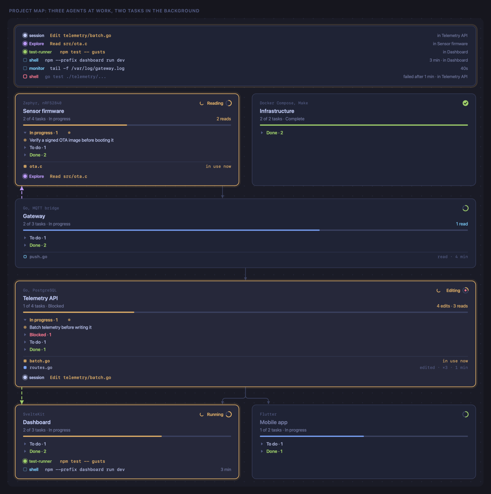
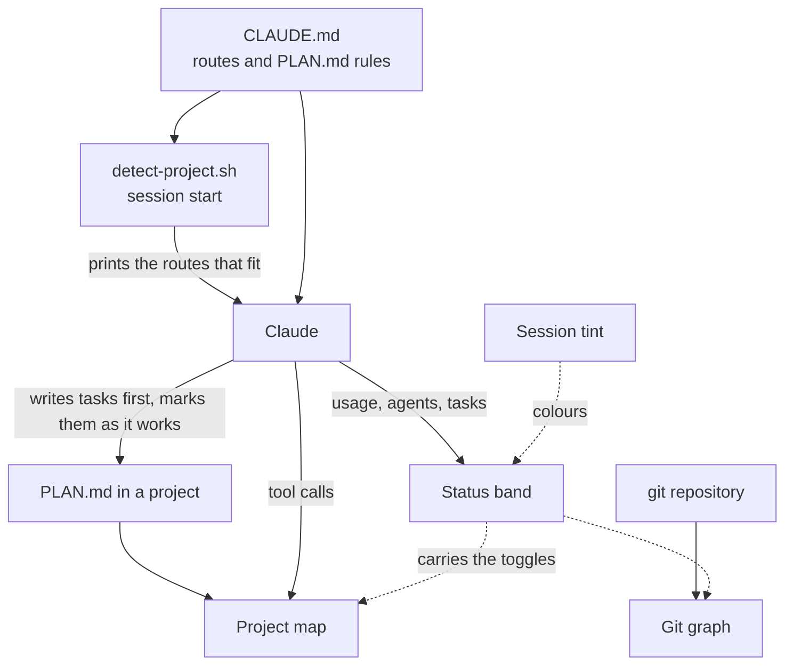

# Claude Code setup

The Claude part of [workbench](../README.md): it is linked into `~/.claude` by `bootstrap.sh claude`.

A working Claude Code setup you can take parts of: four mods that add live panels and a status band to the Claude desktop app, a hook that works out what kind of project you are in and tells Claude which agents and skills to use, and a script that rebuilds the whole thing on another machine.

It is one person's setup, published as it is used. The mods stand on their own and are the part most people will want. The instructions, settings and skill list are personal; read them as an example to adapt, not as defaults.



<sub>The project map, drawn by the mod's own code from a demo plan. All images here are generated from the mods' output with demo content, not captured from the app.</sub>

## What is in it

| Part | What it does | Where |
| --- | --- | --- |
| Status band | A band above the message box: context used, plan limits, session cost, and the agents and background tasks at work. Folds to one row. | [mods/status-band](mods/status-band/README.md) |
| Session tint | Gives each session its own colour, so several open sessions are easy to tell apart. | [mods/session-tint](mods/session-tint/README.md) |
| Project map | Draws a project's `PLAN.md` as cards with their tasks and dependencies, and shows live which agent is working in which part, on which files. | [mods/agent-map](mods/agent-map/README.md) |
| Git graph | The repository's commits as a graph, with a branch filter, a find box, and git actions that each show their command and wait for a yes. | [mods/git-graph](mods/git-graph/README.md) |
| Project detection | A session-start hook that looks at the project's files and prints which agents and skills fit it. | [hooks/detect-project.sh](hooks/detect-project.sh) |
| Open tasks | A Stop and SubagentStop hook: lists background commands and agents still running. The session sees them when it stops; an agent that started background work of its own cannot finish until that work is done or stopped. | [hooks/open-tasks.sh](hooks/open-tasks.sh) |
| Global instructions | `CLAUDE.md`: preferences, the skill routes the hook prints, and the rules for keeping a `PLAN.md`. | [CLAUDE.md](CLAUDE.md) |
| Bootstrap | Links these files into `~/.claude` and reinstalls skills and plugins (`bootstrap.sh claude`). | [bootstrap.sh](../bootstrap.sh) |

## Requirements

- Claude Code with support for mods (plugins that ship a hooks module). Built and used on the macOS desktop app, 2.1.29x. The panels fall back to text in a terminal, but they have only been looked at in the desktop app.
- `git` for the git graph. `jq` for the detection hook and the bootstrap script.
- For the whole setup: macOS, zsh, Homebrew, Node (`npx`).

## Use only the mods

This is the safe way to try them: nothing of yours is replaced.

Clone the repository anywhere:

```bash
git clone https://github.com/mayankgautam-me/workbench.git ~/workbench
```

Add its `mods` folder as a plugin marketplace. The marketplace is called `local-mods`:

```bash
claude plugin marketplace add ~/workbench/claude/mods
```

Install the ones you want:

```bash
claude plugin install status-band@local-mods
```

```bash
claude plugin install session-tint@local-mods
```

```bash
claude plugin install agent-map@local-mods
```

```bash
claude plugin install git-graph@local-mods
```

Restart Claude Code. A mod is loaded when the app starts; `/reload-plugins` alone does not pick up a new or updated one.

Each mod works alone. Together they share one row: the status band and the session's rule carry the buttons that show and hide the project map and the git graph.

To update later, pull and update each installed mod, then restart:

```bash
git -C ~/workbench pull
```

```bash
claude plugin update agent-map@local-mods
```

To remove one:

```bash
claude plugin uninstall agent-map@local-mods
```

## Use the whole setup

Only do this if you want this setup as the base of your own: it replaces your `CLAUDE.md` and `settings.json`, after moving them to `~/.workbench-backup/<time>/`. Fork the repository, clone it to `~/.workbench`, and run `zsh ~/.workbench/bootstrap.sh claude` (or `all` for the whole Mac); the [workbench README](../README.md) has the steps.

Then make it yours:

- **`settings.json`** holds the author's permissions and the list of enabled plugins. It contains no machine-specific path: the mods' marketplace is registered by the script as `~/.claude/mods`. Go through the `permissions` and `enabledPlugins` and keep what you want.
- **`CLAUDE.md`** describes the author's machine, tools and preferences. Rewrite the first sections. Keep the "Skill routing" and "Projects with a PLAN.md" sections if you want the hook and the project map to work as described here.
- **`skills.txt`** is the author's choice of third-party skills. Remove what you do not need before running the script, or uninstall afterwards.

Logging in to Claude is separate; no login data is part of this repository.

## How the parts fit together



### Project detection and skill routing

`hooks/detect-project.sh` runs at session start. It looks at the project's files up to three levels deep, recognises the kind of project (Flutter, React Native, Swift, Android, Tauri, Svelte, Next.js, Go, Rust, Zephyr, Cortex-M, ESP-IDF, PlatformIO, embedded Rust, KiCad, AI and data work, MQTT), and prints a short "Project profile" naming the agents and skills to use.

The hook holds no route text of its own. Each route is a line of `CLAUDE.md` that ends in a marker such as `<!--route:flutter-->`, and the hook prints the marked lines that match. To change what Claude is told for a kind of project, edit that line in `CLAUDE.md` and keep its marker. To check that the two still agree:

```bash
bats ~/.claude/hooks/tests
```

That needs `brew install bats-core`. The `project-profile` skill re-runs the detection by hand.

The routes name agents and skills from the [wshobson/agents](https://github.com/wshobson/agents) marketplace and from `skills.txt`. A route to something you have not installed does nothing useful, so trim the routes to what you have.

### PLAN.md and the project map

A `PLAN.md` at a project's root lists the project's components and their tasks in a small, strict format. The project map draws it. The rules in `CLAUDE.md`, repeated by the mod in every project that has a `PLAN.md`, tell Claude to write the work into the plan before starting and to mark each task as it goes, so the map shows work while it happens. The format and the commands are in the [project map's README](mods/agent-map/README.md).

The workbench's own [PLAN.md](../PLAN.md) is a full example.

### Project standard

The `project-standard` skill gives every project the same layout and the same `make` commands for each stage of work: toolchains and setup, the local runtime, testing, Cloudflare auth, resources and Access, secrets, deployment and deployment testing, GitHub Actions CI, firmware (Zephyr, ESP-IDF, PlatformIO, arm-gcc, CircuitPython, Silicon Labs Simplicity SDK), boards (KiCad, Altium), FreeCAD models, apps and releases. The tools underneath stay what they are; only the commands in front of them are the same everywhere.

- `new` scaffolds a project from the parts you pick, `adopt` moves an existing project over (only when asked), `update` refreshes a project's managed files, and `audit` reports how a project differs.
- Secrets live in one private, SOPS + age encrypted repository for all projects (`~/.secrets`), unlocked on each Mac by a key in the Secure Enclave (Touch ID). Make commands decrypt them into the environment of the one command that needs them, and CI reads the same files with a per-project key.
- The CI jobs are reusable GitHub Actions workflows kept in `skills/project-standard/ci-templates/`, published as the public `mayankgautam-me/ci-templates` (one tag per version, `v1.11` now) that each project's workflows call.
- KiCad boards share a KiCad library repository and Altium boards a shared Altium library, a git submodule of each project that `make <part>-setup` adds; `make ci-setup` gives CI a read-only deploy key for each.
- The session-start hook says whether the folder is on the standard.

The full spec is [skills/project-standard/reference/standard.md](skills/project-standard/reference/standard.md). Its tests:

```bash
bats ~/.claude/skills/project-standard/tests
```

### Versions

Neither the skills installer nor the plugin installer can pin a commit. `versions.lock` records what was installed when it was last written, and `bootstrap.sh` warns when a machine differs from it. After reviewing an upstream change:

```bash
zsh ~/.workbench/bootstrap.sh lock
```

## Layout

Each of these is linked into `~/.claude` under the same name, except this README and `docs/`. `~/.claude` also holds sessions, history, caches and login data; none of that is in the repository.

```
CLAUDE.md                 global instructions, skill routes, PLAN.md rules
settings.json             permissions, the session-start hook, enabled plugins, marketplaces
skills.txt                third-party skills, as owner/repo@skill
versions.lock             skill, marketplace and plugin versions last installed
docs/screenshots/         the images in the READMEs, and the script that generates them
hooks/detect-project.sh   project detection
hooks/open-tasks.sh       background tasks left running (Stop, SubagentStop)
hooks/tests/              its bats tests
skills/project-profile/   skill that re-runs the detection
skills/project-standard/  one layout and command set for every project: templates, CI, secrets, tests
mods/                     the four mods and their marketplace file
```

Every mod has the same shape:

```
mods/<mod>/.claude-plugin/plugin.json   name, version, description
mods/<mod>/hooks/core.ts                pure logic, no access to the app
mods/<mod>/hooks/register.tsx           the hooks: what is drawn, what reacts to what
mods/<mod>/types/index.d.ts             the values the mod keeps in session state
mods/<mod>/tests/                       tests run by `claude plugin test`
```

## Changing a mod

Run a mod's tests and check that the app will accept it:

```bash
claude plugin test mods/agent-map
```

```bash
claude plugin validate mods/agent-map
```

The git graph has two more checks that run its commands against real git in scratch repositories:

```bash
node --experimental-strip-types mods/git-graph/scripts/all-buttons.mts
```

```bash
node --experimental-strip-types mods/git-graph/scripts/real-git-actions.mts
```

After a change, raise the version in the mod's `plugin.json`, update the installed copy and restart the app. Without the version change the app keeps loading the copy it already has.

```bash
claude plugin update agent-map@local-mods
```

## The images

The images in these READMEs are generated, not captured: each mod draws demo content in the test kit, and that drawing is rendered to a PNG. The project map is the mod's own drawing; in the others the layout, colours and text are the mod's, while buttons, inputs and fonts are stand-ins for the app's own. To regenerate them after changing a mod:

```bash
zsh docs/screenshots/make/make.sh
```

## Status and limits

- The mod API these are built on is new and may change between Claude Code releases. A mod that stops loading after an update is most likely that.
- Everything was built and looked at on one machine: an Apple Silicon Mac, the desktop app, a dark theme. The colours are Tokyo Night and are not configurable.
- `bootstrap.sh` has not yet been run end to end on a second machine.
- The tests cover the logic and what each mod draws. They do not cover how it looks on screen.

## Licence

GPL-3.0, as the rest of the workbench: see the [LICENSE](../LICENSE). The third-party skills and plugins named in `skills.txt` and `settings.json` are not part of this repository and carry their own licences.
