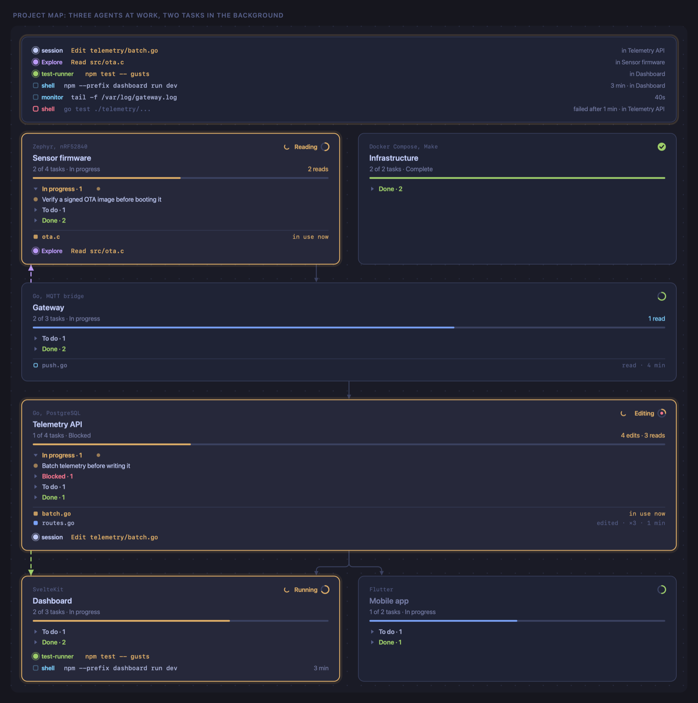
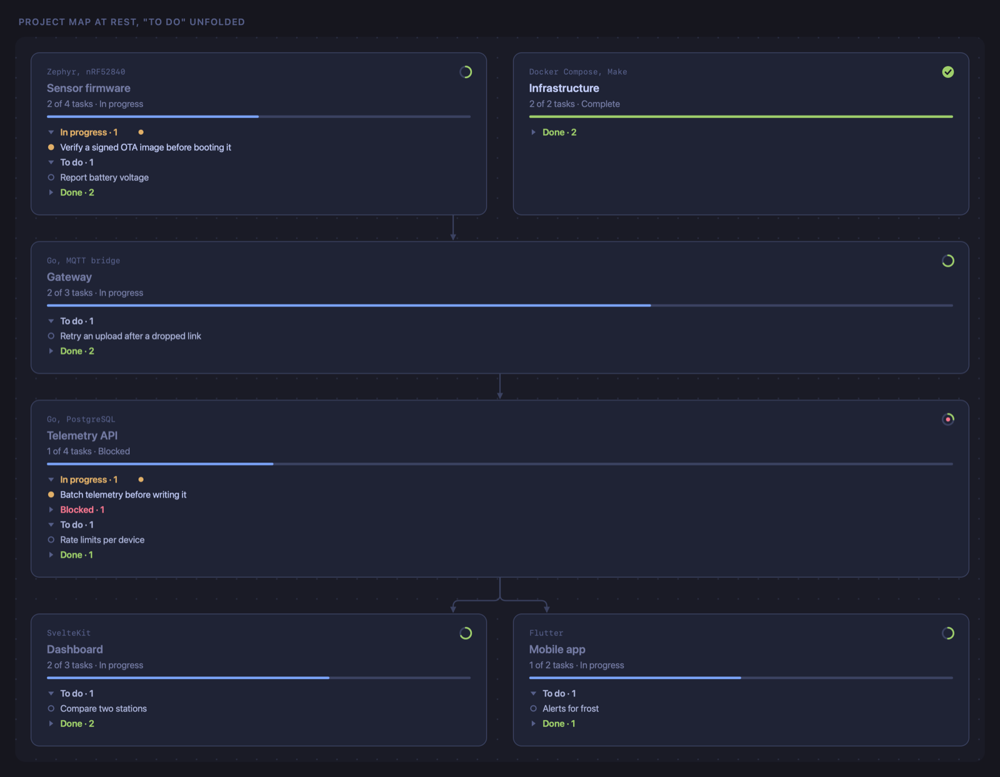

# Project map

A panel that draws a project's `PLAN.md` as a map: one card per component with its tasks, arrows for what depends on what, and, while Claude works, which agent is in which component, on which files, doing what.

The panel and its button exist only in a project that has a `PLAN.md` at its root.



<sub>Drawn by the mod's own code from a demo plan, not captured from the app.</sub>

## What the map shows

**At rest**

- A card per component: its name, its technology, how many of its tasks are done, and a progress bar.
- Its tasks grouped by status. "In progress" is always listed; "Blocked", "To do" and "Done" are one line each until unfolded from the row above the map.
- A grey arrow from each component to the ones that need it.
- The files touched in a component this session, each with a filled square for edited or a hollow one for read, and how long ago.



**While something is working**

- A session card on top with a row per agent: its name, what it is doing, and which component it is in.
- The card being worked in has a lit edge, a spinner and a word for the activity (Reading, Editing, Thinking), and a row for each agent in it.
- When an agent moves from one component to another, a dashed line in the agent's colour runs from the card it left to the one it is on. Each agent's line has its own track.
- A task marked in progress has a pulsing amber dot.

When an agent ends, its row goes; nothing is left on the card.

### Background tasks

What the session leaves running in the background is on the map too: a shell command sent to the background (or moved there when it ran long), a monitor, a workflow. A subagent is an agent, drawn as above.

- Each is a row on the session card under the agents: a hollow square, its kind, its command, how long it has run, and the component it works in.
- Where its command names a path in a component, the same row sits at the foot of that component's card for as long as it runs.
- The square is cyan while it runs, green once it is done, red where it failed and grey where it was stopped. An ended task stays on the session card, saying how it ended and after how long, until your next prompt.
- A task is seen when the call that starts it returns, and its end when its notification arrives or it is stopped. Each time the session stops, the map is also set against the engine's own list of what is in flight: a task it missed is added, and one that is gone is marked done. How a task that was only found gone ended is not known, so it reads as done.
- Obvious secrets in a command are not shown, as for an agent's call.

## Commands

| Command | What it does |
| --- | --- |
| `/map` | Shows or hides the panel. |
| `/map refresh` | Reads `PLAN.md`, the project's files and the session's agents again and redraws the map, shown or hidden as it was. |
| `/map init` | Asks Claude to write a `PLAN.md` for the project from its real structure. |
| `/map check` | Checks `PLAN.md` for anything the map cannot read. |

With [status-band](../status-band/README.md) or [session-tint](../session-tint/README.md) installed, a `map` button on their row does what `/map` does without typing.

## The PLAN.md format

The map reads only this format. Anything written another way is ignored, so a component that is not in it does not appear.

```markdown
# my-project

## Web app {#web}
tech: SvelteKit
files: [apps/web/**, package.json]
needs: [api]
- [x] Sign-in page {#web-sign-in}
- [~] Settings page {#web-settings}
- [ ] Dark theme {#web-dark}

## API {#api}
tech: Go
files: [services/api/**]
- [x] Sessions {#api-sessions}
- [!] Rate limits: waits on the gateway {#api-limits}

## decisions
- 2026-01-10: sessions are cookies, not tokens
```

- **A component** is a heading `## Name {#id}`. The id is letters, digits, `-` and `_`, unique in the file. A `##` heading without `{#id}`, such as `## decisions`, is not drawn.
- **Under it**, one per line and not as list items:
  - `tech:` a few words shown at the top of the card.
  - `files:` globs relative to the project root, `**` for any depth. The first component that claims a file gets it. A file no component claims shows on an "Unplanned files" card. Once a component claims it, the file, what was done to it and the agent working on it move to that component, and the card goes when nothing is unplanned.
  - `needs:` the ids this component depends on. Drawn as arrows.
  - `links:` a looser relation. Kept in the file, not drawn.
  - `kind:` free text.
- **Tasks** are list items directly under the component: `- [ ] text {#task-id}`.

| Mark | Meaning |
| --- | --- |
| `[ ]` | To do |
| `[~]` | In progress |
| `[x]` | Done |
| `[!]` | Blocked; say why in the task line |

## How the map stays live

The mod does three things beyond drawing:

1. **It reads `PLAN.md` again whenever it changes**, whether Claude edited it or a shell command did, so a ticked task shows at once.
2. **It checks the file after every edit** and adds what the map cannot read to the edit's result, as `PLAN.md:<line>: error: ...` or `note: ...`, so Claude fixes it in the same turn. A note covers things worth a look, such as a glob that matches no file.
3. **It tells Claude to plan first.** In every project with a `PLAN.md` it adds a short section to the system prompt: put the work into the plan before starting, mark the task being worked on `[~]`, mark it `[x]` when done. If files are edited while no task is in progress, it reminds Claude once per turn.

Which component a tool call belongs to is decided by the file it touches, matched against the `files:` globs. A shell command lights the component whose files it names.

## Install

See [the repository's README](../../README.md#use-only-the-mods).

```bash
claude plugin install agent-map@local-mods
```

Then, in a project:

```
/map init
```

## Layout

- Components are placed top to bottom, each below what it needs. A row's cards share the panel's width.
- A narrow panel shows one column without dependency arrows; they would only be vertical lines through the cards.
- Lines keep 16 px from a card and 12 px from each other; gaps grow to fit the lines that run through them.

## Limits

- The map is one drawing, so it cannot be clicked: task groups are unfolded from the row above it.
- In a terminal there is no drawing; the panel lists the components and tasks as text.
- At most 250 tasks are read from one file.
