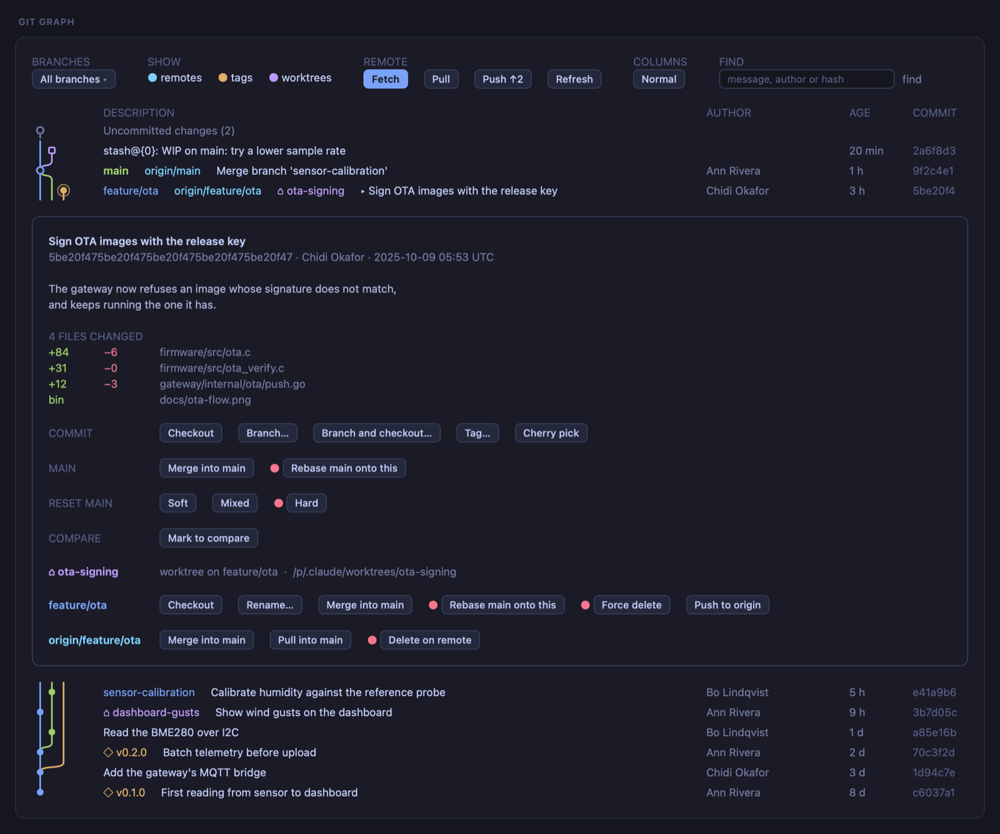
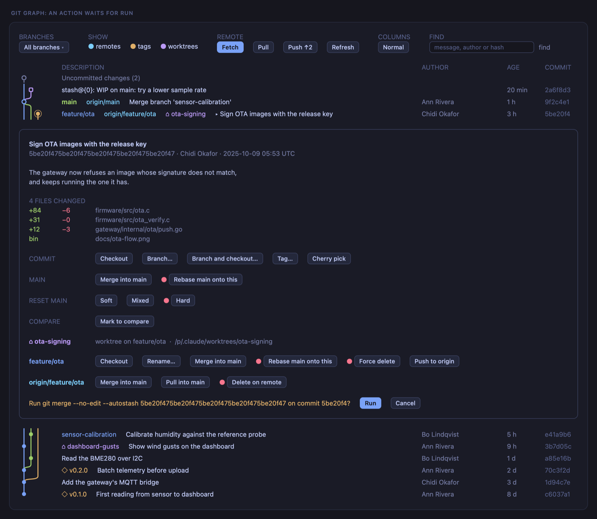
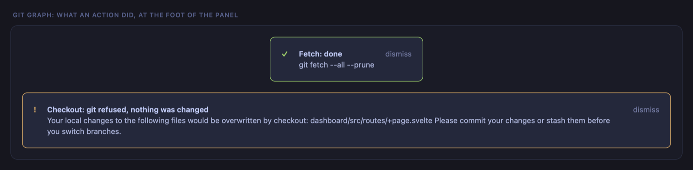

# Git graph

A panel that draws the repository's commits as a graph and lets you act on them, modelled on the [Git Graph](https://github.com/mhutchie/vscode-git-graph) extension for VS Code.

The panel and its button exist only when the session is inside a git repository.



<sub>Generated from the mod's own output with demo content, not captured from the app: layout, colours and text are the mod's; buttons and fonts are stand-ins for the app's own.</sub>

## What it shows

- **The graph:** every commit as a row, with lanes for branches and merges, and the labels of the branches, remote branches and tags on it.
- **Worktrees:** each other worktree of the repository, such as the ones Claude sessions work in, is named in purple (`⌂ name`) on the commit it has checked out; the commit's card says which branch it is on and where its folder is. A worktree on a detached HEAD is drawn too, though no branch reaches its commits. The graph only shows them: nothing is done to a worktree from here.
- **Uncommitted changes** as a row of their own on top, listing the changed files.
- **Stashes**, each hanging off the commit it was made on.
- **Columns** for author, age and commit hash, in three widths (compact, normal, wide). Columns drop out as the panel narrows; the description always keeps room.

The toolbar has a branch filter, switches for remote branches, tags and (where the repository has any) worktrees, Fetch, Pull, Push and Refresh (Push and Pull say how many commits the branch is ahead of its upstream and behind it, as in `Push ↑5`; the counts are as of the last fetch), the column width, and a find box that matches message, author and hash.

The toolbar, and under it a command waiting for **Run** or the bar of a merge in progress, stays at the top of the panel; the commits scroll under it, the whole history as one list. A panel shorter than 16 rows has no room for both: it scrolls as a whole, a page of commits at a time, with "older commits" and "newer commits" to move between pages.

Selecting a row opens a card with the commit's full message, the files it changed with lines added and removed, and the actions for the commit and for each branch or tag on it. Marking one commit and selecting another lists what differs between the two.

## Actions

Nothing runs on one press. Every action shows the exact git command it will run and waits for **Run**. Actions that rewrite, delete or discard are marked in red and say so.



| On | Actions |
| --- | --- |
| A commit | Checkout, Branch, Branch and checkout, Tag, Cherry pick, Revert, Merge into the current branch, Rebase the current branch onto it, Reset (soft, mixed, hard) |
| A local branch | Checkout, Rename, Merge, Rebase onto it, Delete, Force delete, Push |
| A remote branch | Checkout as a local branch, Merge, Pull, Delete on the remote |
| A tag | Push, Delete |
| A stash | Apply, Pop, Branch from it, Drop |
| Uncommitted changes | Stash, Discard tracked changes, Delete untracked files |
| The repository | Fetch, Pull, Push |

An action is offered only where git will accept it. For example, Cherry pick and Merge are not offered on a commit that is already in the current branch's history, and Pull is offered only when the branch has an upstream.

Three choices are built in and differ from plain git:

- Merge, Rebase and Pull use `--autostash`, so uncommitted changes are set aside and put back.
- Pull always merges (`--no-rebase`), whatever `pull.rebase` is set to.
- A merge commit is cherry-picked or reverted against its first parent (`-m 1`).

When a merge, cherry-pick, revert or rebase stops on a conflict, a bar at the top of the panel offers **Continue** and **Abort**, and only the actions that are safe meanwhile stay.

## Messages

What an action did is said in a toast pinned to the bottom centre of the panel. It stays there while the graph scrolls behind it.



| Mark | Meaning | Stays |
| --- | --- | --- |
| ✓ | Done | 5 s |
| i | Running, or information | 5 s |
| ! | Git refused and nothing was changed, or an operation stopped on a conflict | 10 s |
| ✕ | Failed | until dismissed |

## Commands

| Command | What it does |
| --- | --- |
| `/graph` | Shows or hides the panel. |
| `/graph refresh` | Reads the repository again. |

With [status-band](../status-band/README.md) or [session-tint](../session-tint/README.md) installed, a `graph` button at the right end of their row does what `/graph` does. Without them the mod draws its own.

The graph is read again after a git command Claude runs and at the end of each turn.

## Install

See [the repository's README](../../README.md#use-only-the-mods).

```bash
claude plugin install git-graph@local-mods
```

## Checks

The mod's tests press every button the panel draws. Whether git accepts each command is checked separately, against real git in scratch repositories:

```bash
node --experimental-strip-types scripts/all-buttons.mts
```

This reads a repository the way the panel does, in six states (clean, uncommitted changes, a branch with no upstream, a detached HEAD, no remote, a merge stopped on a conflict), and runs every action offered. The only refusals it accepts are git protecting uncommitted work, with nothing changed.

## Limits

- Fetch, Pull and Push run without a terminal: a remote that asks for a password or passphrase will fail. Use an SSH agent or a credential helper.
- 150 commits are read at a time, and the next 150 are read from git as the list is scrolled near its end. The panel draws only the rows in view: the app draws nothing of a panel over 100,000 characters and says "nothing to show yet" instead. In a panel shorter than 16 rows, which pages instead, a page is shorter where many branch lines run side by side.
- Tabs, carriage returns and escape sequences in commit messages, file names and what git says are not drawn: the app refuses a panel that holds one.
- In a terminal the graph is drawn with characters instead of lines.
- The app hands a panel its wheel only while its window can move that way, and not at its edges, so the drawing is two rows taller than the panel and, after each tick, the window is put back on the row between them, with room to move up and down. The panel is drawn shifted by however far the app moves its window over those rows, so it stays in place. Each tick still draws the panel twice, once where the app moved the window and once put back, which can show as a slight flicker; a window that drifted with the wheel jerked more, and one that never moved got no wheel at all.
