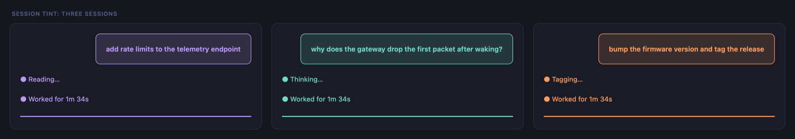

# Session tint

Gives each session its own colour, so that several sessions open side by side are easy to tell apart.



<sub>Generated from the mod's own output with demo content, not captured from the app: layout, colours and text are the mod's; buttons and fonts are stand-ins for the app's own.</sub>

## What it colours

- A thin rule above the message box. On a folded [status band](../status-band/README.md) it is a bar at the start of the band instead.
- Your own prompts in the transcript.
- The spinner while Claude works.
- The line that closes a turn, with how long the turn took.

## Choosing the colour

A session gets a colour by itself, worked out from its id, so the same session keeps the same colour.

| Command | What it does |
| --- | --- |
| `/tint <name>` | Sets this session's colour. |
| `/tint auto` | Goes back to the colour chosen for the session. |

The names are `blue`, `purple`, `cyan`, `green`, `yellow`, `orange`, `red`, `teal` and `pink`, all from the Tokyo Night palette.

## With the other mods

The rule carries the buttons of the other mods when they are installed: `map` at its left end for the [project map](../agent-map/README.md), `graph` at its right end for the [git graph](../git-graph/README.md).

## Install

See [the repository's README](../../README.md#use-only-the-mods).

```bash
claude plugin install session-tint@local-mods
```

## Limits

- The palette is fixed and made for a dark theme.
