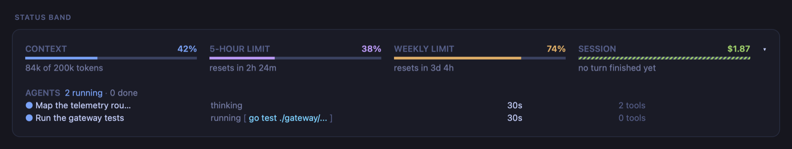
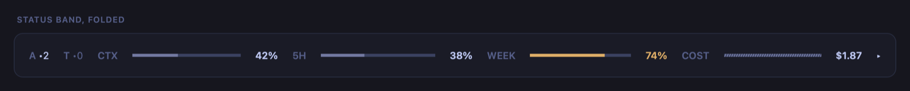
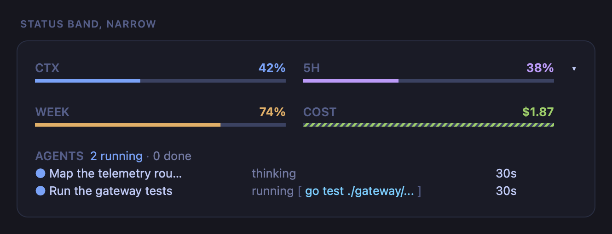

# Status band

A band above the message box that shows, live, how much of the session's limits are used and what is running.





<sub>Generated from the mod's own output with demo content, not captured from the app: layout, colours and text are the mod's; buttons and fonts are stand-ins for the app's own.</sub>

## What it shows

Four gauges, each a bar, a figure and a line of detail:

- **Context:** how much of the model's context window the conversation fills, in percent and in tokens.
- **5-hour:** how much of the plan's five-hour limit is used, and when it resets.
- **Weekly:** the same for the weekly limit.
- **Session:** what the session has cost so far.

A gauge turns amber from 70% and red from 90%.

Below the gauges, while there are any:

- **Agents:** a row per subagent with what it is doing right now, how long it has run and how many tool calls it has made.
- **Background tasks:** a row per background command, running or finished.

Secrets in a command (tokens, passwords, keys) are masked before a command is shown.

## Folding

The mark at the right end folds the band to one row: the four gauges side by side, with counts of agents (`A`) and tasks (`T`) in front. The choice is remembered between sessions.

## Width

The band follows the width it is given.

- **Unfolded:** full detail when wide, shorter detail when medium, two rows of two with short labels when narrow.
- **Folded:** full labels and bars, then short labels, then figures without bars, and at its tightest the gauges wrap onto a second row instead of being cut off.



## Commands

| Command | What it does |
| --- | --- |
| `/band` | Shows or hides the band. |

## With the other mods

- With [agent-map](../agent-map/README.md) installed, the band carries the button that shows and hides the project map.
- With [git-graph](../git-graph/README.md) installed, it carries the graph's button at its right end.
- With [session-tint](../session-tint/README.md) installed, the folded band takes the session's colour.

## Install

See [the repository's README](../../README.md#use-only-the-mods).

```bash
claude plugin install status-band@local-mods
```

## Limits

- The plan limits are shown as the app reports them. Until the first reply of a session there is no context reading.
- The session cost is the app's own figure; on a subscription plan it is an equivalent, not a charge.
